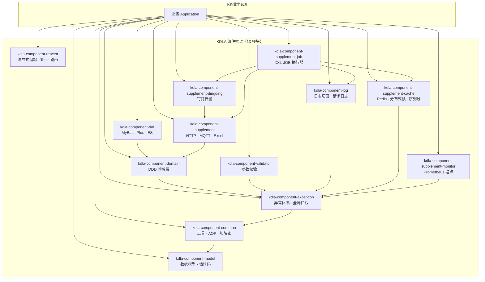
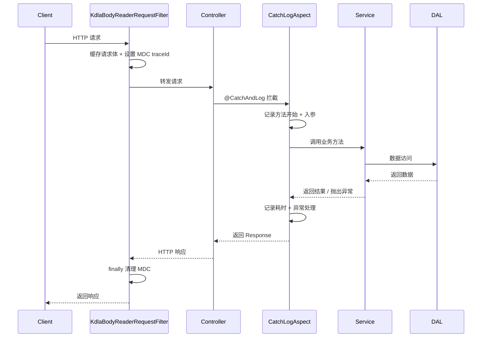
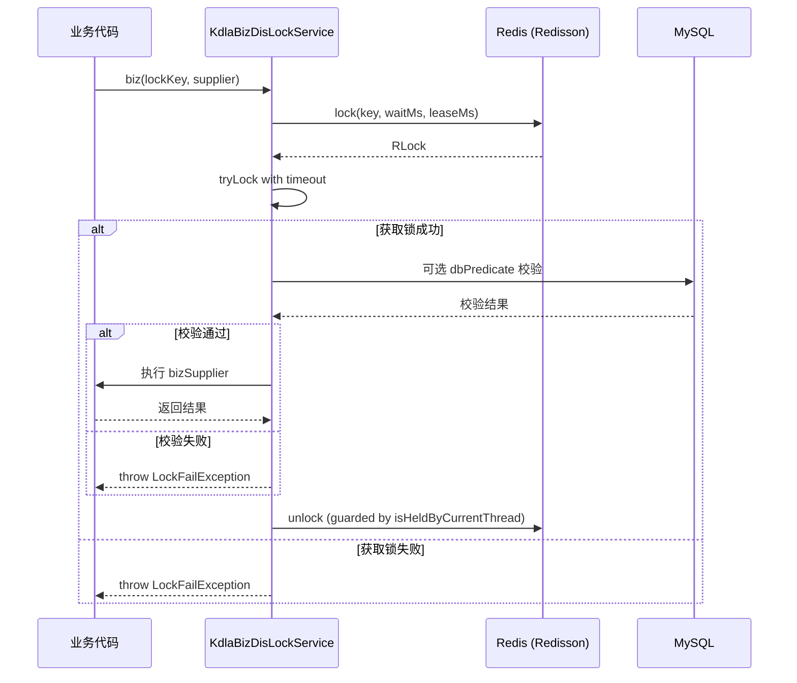
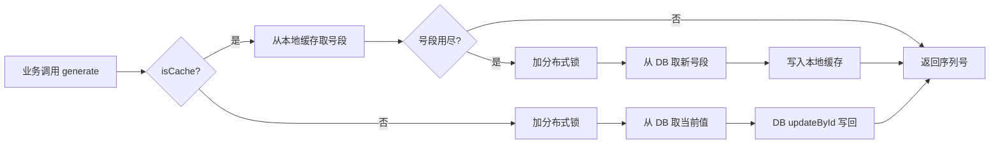

# 架构说明

> KDLA 基础组件框架的架构设计与核心决策解释。

## 系统概览

KDLA（K-DDD-Layered Application & Architect）是一个基于 DDD 分层架构的 Java 基础组件框架。它不是可运行的应用，而是一组发布到公司内部 Nexus（`nexus.enncloud.cn`）的 Maven 库，供下游业务项目引入后通过 Spring Boot 自动配置获得统一的技术支撑能力。

核心目标：
- 统一技术选型，降低团队协作成本
- 通过自动配置减少重复开发
- 作为多个业务项目的共同依赖基座，保证技术栈一致性

技术基线：Java 8 编译目标 + Spring Boot 2.7.18 + Spring Cloud 2021.0.9。

> ⚠️ 本仓与另一裁剪版仓库（9 模块）共享 GAV `top.kdla.framework:*:1.0.1-SNAPSHOT`，且同名配置键默认值语义相反（本仓多数默认开）。排障与升级前先确认构件来源：`mvn dependency:tree` + 仓库地址。详见 CHANGELOG 2026-11-16 块。

## 架构图



## 模块依赖流向

依赖严格自下而上流动（以各模块 pom 实际声明为准）：

1. **零依赖层**：`model`（除 Lombok）、`reactor` 不依赖任何内部模块
2. **common 层**：依赖 model，提供工具类和 AOP 能力，所有外部依赖使用 `provided` scope
3. **exception 层**：依赖 model + common，定义异常体系与全局拦截
4. **domain 层**：依赖 common + exception，DDD 共享内核
5. **横切/支撑层**：dal（依赖 domain）、log、validator、supplement（依赖 domain）、supplement-cache、supplement-monitor 依赖 exception 及以下
6. **聚合层**：supplement-dingding 依赖 supplement；supplement-job 聚合最多（supplement / supplement-cache / supplement-dingding / log / domain）

给底层模块加依赖会成环，改 pom 前先看本流向。

## 核心模块表

| 模块 | 职责 | 关键类 | 自动配置（T 默认） |
|------|------|--------|---------|
| model | 数据模型与错误码契约 | `Response`, `Command`, `ErrorCode` | 无 |
| reactor | 响应式追踪与 Topic 路由 | `TraceMono`, `TraceFlux`, `TopicRouter`, `Reactors` | 无 |
| common | 通用工具与 AOP | `AESUtil`, `Sm4Util`, `ThreadPoolHelp`, `MdcAspect` | `MdcAutoConfigure` (**ON**), `StopWatchAutoConfigure` (**ON**) |
| exception | 统一异常体系 | `BizException`, `UnifiedExceptionControllerAdvice` | advice 自动注册 (**ON**, SERVLET) |
| validator | Bean Validation 扩展 | `@EnumValid`, `@DBLengthValid`, `CommonValidator` | `ValidatorAutoConfigure` (**ON**) |
| log | 方法日志与请求日志 | `@CatchAndLog`, `RequestLogAspect`, `LogInterceptor` | `CatchLogAutoConfigure` (**ON**)；RequestLog / LogInterceptor / WebFilter (OFF) |
| domain | DDD 共享内核 | `Entity`, `Specification`, `DomainEvent` | `DomainAutoConfigure` (**ON**, 无开关) |
| dal | 数据访问基类 | `BaseDo`, `MpBaseDo`, `PageConvertor`, `SqlFilter` | 无 |
| supplement | HTTP/MQTT/Excel/CORS | `KdlaHttpClient`, `MqttClientImpl`, `KdlaExcelWrite` | Vertx / VertxHttp / FieldValueFind (**ON**)；RestHttp / MQTT / CORS (OFF) |
| supplement-cache | 缓存/锁/序列号 | `KdlaBizDisLockService`, `SequenceNoGenerator`, `SpringRedisHelp` | `RedissonAutoConfigure` (**ON**)；Cache / SequenceNo (OFF) |
| supplement-dingding | 钉钉机器人告警 | `DingDingService`, `DingAlertConfigure` | `DingAlertConfigure` (**ON**, 无开关, OnClass(Vertx)) |
| supplement-monitor | Prometheus 埋点推送 | `@PrometheusCounter`, `PushGatewayManager` | `PrometheusAutoConfigure` (**ON**, 无开关, OnClass(prometheus)) |
| supplement-job | XXL-JOB 执行器封装 | `XxlJobSpringExecutor`, `@XxlJob`, `JobThread` | 无 |

## 自动配置机制

KDLA 使用 Spring Boot 2.x 的 `spring.factories` 机制（非 SB3 的 `AutoConfiguration.imports`）。各模块在 `META-INF/spring.factories` 中注册自动配置类；新增 auto-config 类必须同步登记，否则不生效。

关键设计决策（T 侧装配契约）：
- **T 与裁剪版参考仓不同**：T 存量下游已依赖默认开启行为，故 9 类有运行期行为的配置类 `matchIfMissing=true` 默认开，另有 3 类无开关靠 `@ConditionalOnClass` 守护；6 类有侵入性副作用的默认关
- `UnifiedExceptionControllerAdvice` 经 spring.factories 自动注册，默认开（`kdla.exception.handler.enabled`），仅 SERVLET 应用生效
- 所有可替换 Bean 使用 `@ConditionalOnMissingBean` 保护
- 所有 `@ConditionalOnClass` 引用真实外部类（如 `Aspect`、`RedissonClient`、`Vertx`、`CollectorRegistry`），不引用自身模块内部类（恒真无意义）

### 装配矩阵

| 默认 | 配置类（开关键） |
|---|---|
| **开** | `MdcAutoConfigure`（`kdla.config.mdc.enabled`）、`StopWatchAutoConfigure`（`kdla.config.stop-watch.enabled`）、`CatchLogAutoConfigure`（`kdla.config.catch-log.enabled`）、`UnifiedExceptionControllerAdvice`（`kdla.exception.handler.enabled`）、`ValidatorAutoConfigure`（`kdla.config.validator.enabled`）、`DomainAutoConfigure`（无开关）、`RedissonAutoConfigure`（`kdla.cache.redisson.enabled`）、`VertxConfigure`（`kdla.config.vertx.enabled`）、`VertxHttpConfigure`（`kdla.config.vertx-http.enabled`）、`FieldValueFindConfigure`（`kdla.config.field-value-find.enabled`）、`DingAlertConfigure`（无开关）、`PrometheusAutoConfigure`（无开关） |
| **关** | `RequestLogAutoConfigure`（`kdla.config.request-log.enabled`）、`LogInterceptorAutoConfigure`（`kdla.config.log-interceptor.enabled`）、`WebFilterAutoConfigure`（`kdla.config.web-filter.enabled`）、`CacheAutoConfigure`（`kdla.cache.enabled`，另需容器存在 `RedisTemplate`）、`RestHttpConfigure`（`kdla.config.rest-http.enabled`）、`VertxMqttConfigure`（`kdla.config.mqtt.enabled`）、`CustomCorsConfig`（`kdla.config.cors.enabled`）、`SequenceNoConfigure`（三键 OR，见下） |

### 配置键速查

| 功能 | 配置键 | T 默认 |
|------|--------|------|
| MDC 追踪 | `kdla.config.mdc.enabled` | **true** |
| 性能监控 | `kdla.config.stop-watch.enabled` | **true** |
| 方法日志 | `kdla.config.catch-log.enabled` | **true** |
| 异常拦截 | `kdla.exception.handler.enabled` | **true** |
| 参数校验 | `kdla.config.validator.enabled` | **true** |
| Vertx 基础 | `kdla.config.vertx.enabled` | **true** |
| Vertx HTTP 客户端 | `kdla.config.vertx-http.enabled` | **true** |
| HTTP SSL trust-all | `kdla.http.ssl.trust-all` | false（开启有 MITM 风险告警） |
| HTTP 请求超时 | `kdla.http.request-timeout` | 30000ms |
| Redisson | `kdla.cache.redisson.enabled` | **true** |
| Spring Cache | `kdla.cache.enabled` | false |
| 请求日志 | `kdla.config.request-log.enabled` | false |
| 日志拦截器 | `kdla.config.log-interceptor.enabled` | false |
| Web Filter | `kdla.config.web-filter.enabled` | false |
| Rest HTTP | `kdla.config.rest-http.enabled` | false |
| MQTT | `kdla.config.mqtt.enabled` | false |
| CORS | `kdla.config.cors.enabled` | false |
| 字段值查找 | `kdla.config.field-value-find.enabled` | **true** |
| 序列号 | `kdla.sequence.enabled` 或 `top.kdla.framework.supplement.cache.sequence.enable` 或 `top.kdla.framework.supplement.sequence.enable` | false（任一为 true 即启用） |

> **注意**：`CatchLogAutoConfigure` 读取的是 `kdla.config.catch-log.enabled`，不是 `kdla.log.catch-log.enabled`。以 `@ConditionalOnProperty` 源码为准。
> **注意**：序列号模块使用 `@ConditionalOnExpression` OR 逻辑，三个配置键任一为 true 即启用；且联动 `@ConditionalOnBean(RedissonRedDisLock)` + `@AutoConfigureAfter(RedissonAutoConfigure)`——Redisson 装配才装配。
> **注意**：上表默认值为 T 仓语义。同名键在裁剪版参考仓多为默认关，两仓共享 GAV，混用构件会导致行为完全相反。

## 数据流

### 请求处理链路



### 分布式锁流程



### 序列号生成流程



## 依赖作用域策略

KDLA 是库项目，几乎所有第三方依赖默认使用 `provided` scope。这意味着：
- KDLA 自身不向下游传递运行时依赖
- 下游应用必须自行引入 Spring Boot、MyBatis-Plus、Redisson、Vert.x 等依赖
- 避免依赖冲突，由消费方控制完整 classpath
- 新增依赖默认评估是否 provided；第三方版本集中在根 pom `<properties>`，模块间依赖版本由根 pom `dependencyManagement` 统一管理（`${project.version}`），模块 pom 内不写版本号
- `snakeyaml 1.33` 与 `spring-kafka 2.9.12` 是刻意 pin 的（绕过 boot 2.7.14 的 bug），勿随 BOM 升级

## 版本与分支约定

- 分支名即版本线：`1.0.1-SNAPSHOT`（JDK 8 / Boot 2.7.18，当前）、`2.0.0-SNAPSHOT`（JDK 21 / Boot 3.4.0，改用 `AutoConfiguration.imports`）
- 版本号硬编码：根 pom `<version>` 与 `kdla.framework.version` property、外加 13 个模块 pom 的 parent `<version>`，升版本需全部同步（无 flatten/`${revision}`）
- 提交信息风格：`kdla <version> and upgrade <topic>`

## 测试

- 栈：JUnit 5 + Mockito（`mockito-junit-jupiter`），经 provided 作用域 `spring-boot-starter-test` 引入，不向下游传递
- 当前 64 个测试类 / 171 个用例，分布于 model、common、exception、domain、dal、validator、supplement、supplement-cache、log 等模块
- 有测试设施的模块，bugfix / 非平凡改动提交须带回归测试
- 验证命令必须带 `-am`（`~/.m2` 中同 GAV SNAPSHOT 可能被另一仓 install 污染）：

```bash
mvn -pl kdla-component-common -am clean test
```

## 已知限制

| ID | 模块 | 限制 | 状态 |
|----|------|------|------|
| K1 | exception/log | `CatchLogAspect` 仅识别 KDLA 自有异常类型，下游自定义异常会落入 `UNKNOWN_ERROR` | 待处理 |
| K3 | dal | `BaseDo.isDeleted`（Boolean）与 MyBatis-Plus 逻辑删除不兼容，需使用 `MpBaseDo` | 已部分处理 |
| K5 | domain | `ApplicationContextHelp` 静态方法不可 mock，强制集成测试 | 待处理 |
| P1 | supplement-cache | `MachineIdHelp` 注册失败脏值残留可能撞号（数据正确性风险） | 待裁定，见 `docs/nit-inventory.md` |

> K2（`KdlaBizDisLockService` 死锁风险）已在 2026-08-28 修复；K4（`SequenceNoGenerator` 缺装配开关）已在 2026-09-04 修复。
> 其余上游同源遗留 19 项（P2-P20）登记于 `docs/nit-inventory.md`，只登记不修（与参考仓保持 diff 可核验）。

## FAQ

### 下游项目如何启用异常全局拦截？

T 仓默认已启用：`UnifiedExceptionControllerAdvice` 经 spring.factories 自动注册（SERVLET 应用），未处理异常统一转 `Response` 兜底文案。不想要需显式 `kdla.exception.handler.enabled=false`。（裁剪版参考仓需显式 `@Import`，与本仓不同。）

### `BaseDo` 和 `MpBaseDo` 怎么选？

- 使用 MyBatis-Plus 的项目：选 `MpBaseDo`（`@TableLogic Integer deleted`，与 MP 逻辑删除配置对齐）
- 不使用 MP 的项目：选 `BaseDo`（`Boolean isDeleted`）

### `AESUtil` / `Sm4Util` 加密后的密文格式是什么？

统一为 `v1:Base64(IV + ciphertext)`（随机 IV + 版本前缀）。解密时检查 `v1:` 前缀区分新旧格式：有前缀使用随机 IV 解密，无前缀回退旧格式以兼容历史密文。新加密的密文（带 `v1:` 前缀）无法被旧版本的 `decrypt` 方法解密。`Sm4Util` 密钥文本编码统一 Base64，存量 Hex 编码密钥不可读（byte[] 重载可绕过）。

### `@CatchAndLog` 注解的作用范围？

`@CatchAndLog` 是类级别注解，使用 `@within` 切点，标注后类内所有 public 方法都会被拦截。没有方法级别的排除机制。仅 `Response` 可赋值返回类型会转失败响应；`Error` 一律 rethrow（保证事务回滚）。

### `@DistributeLocked` 的锁 key SpEL 有什么限制？

SpEL 上下文为 `SimpleEvaluationContext.forReadOnlyDataBinding()`（防注入），仅支持纯属性访问（如 `#param.fieldName`），方法调用 / bean 引用（如 `#args[0].getKey()`）不支持。锁获取失败抛 `LockFailException`。

### 序列号生成器需要什么前置条件？

1. MySQL 表 `code_generator_cfg`（DDL 在 `kdla-component-supplement-cache/src/main/attachment/sql/`）
2. Redis（Redisson）已装配（`SequenceNoConfigure` 联动 `@ConditionalOnBean(RedissonRedDisLock)`）
3. 三个配置键任一为 true（见配置键速查）+ `kdla.sequence.lock.key.prefix`

### 如何发布到内部 Nexus？

```bash
mvn deploy
```

需公司内网/VPN，并在 `~/.m2/settings.xml` 中配置 server ID `kdla-nexus` 的凭据，指向 `nexus.enncloud.cn`。
